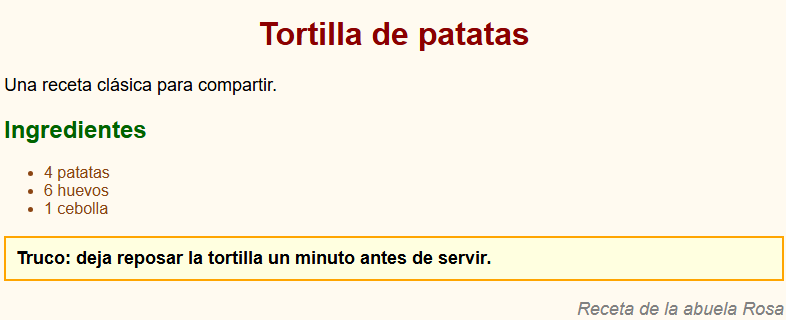

# TAREA 01 (RA1): La receta con estilo
Aplicación de estilos CSS mediante selectores de elemento, clase e ID, utilizando las tres formas de insertar CSS: externo, interno y en línea.

## 🚀 Resultado Visual

## 🛠️ Tecnologías utilizadas
- HTML5
- CSS3
- Visual Studio Code

## 📋 ¿Qué se hizo? (Funcionalidades)
- **Selectores de elemento:** Aplicación de estilos a etiquetas `body`, `h1`, `h2`, `p` y `li`.
- **Selector de clase (`.destacado`):** Personalización del párrafo del truco con fondo amarillo claro y texto en negrita.
- **Selector de ID (`#autor`):** Estilización del autor de la receta con color gris, cursiva y alineación a la derecha.
- **CSS externo:** Creación de `estilos.css` y conexión con `index.html` mediante la etiqueta `link`.
- **CSS en línea:** Aplicación de estilos directamente en las etiquetas HTML mediante el atributo `style`.
- **CSS interno:** Aplicación de estilos mediante un bloque `<style>` dentro del `head`, utilizando una única regla para ambos párrafos.
- **Reto opcional:** Incorporación de un borde naranja y relleno interior al elemento destacado.

## ⚙️ Cómo ejecutarlo localmente
1. Clona o descarga el proyecto.
2. Abre la carpeta del proyecto en Visual Studio Code.
3. Abre cualquiera de los tres archivos HTML (`index.html`, `en-linea.html` o `interna.html`) en un navegador web.
4. Comprueba los resultados visuales de cada una de las tres formas de aplicar CSS.