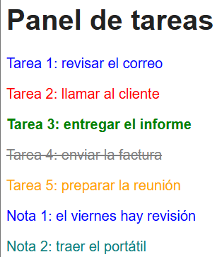

# TAREA 02 (RA1): La cascada en un panel de tareas
Aplicación de CSS para trabajar la cascada, la especificidad, el orden de las reglas, `!important` y la herencia de estilos.

## 🚀 Resultado Visual

## 🛠️ Tecnologías utilizadas
- CSS3
- HTML5
- Visual Studio Code

## 📋 ¿Qué se hizo? (Funcionalidades)
- **Selectores y especificidad:** Aplicación de reglas mediante selectores de elemento, clase e ID para establecer diferentes estilos en las tareas.
- **Orden de las reglas:** Resolución de conflictos entre `.urgente` y `.hecha` para mostrar correctamente las tareas completadas.
- **Uso de `!important`:** Aplicación en la Tarea 5 para conseguir que el color naranja prevalezca sobre el atributo `style` del HTML.
- **Herencia de estilos:** Aplicación del color teal a la zona de notas mediante una única regla, diferenciando el comportamiento del párrafo y el `span`.
- **Orden de carga de CSS:** Comparación de los resultados al colocar el bloque `<style>` antes y después del enlace a la hoja de estilos externa.
- **Comprobación de resultados:** Verificación de los colores y estilos mediante el navegador y las herramientas de desarrollador (F12).

## ⚙️ Cómo ejecutarlo localmente
1. Clona o descarga el proyecto.
2. Abre la carpeta del proyecto en Visual Studio Code.
3. Abre cualquiera de los siguientes archivos HTML en un navegador:
   - `index.html`
   - `style-antes-de-link.html`
   - `style-despues-de-link.html`
4. Compara los resultados para comprobar cómo influyen la especificidad y el orden de las reglas CSS.