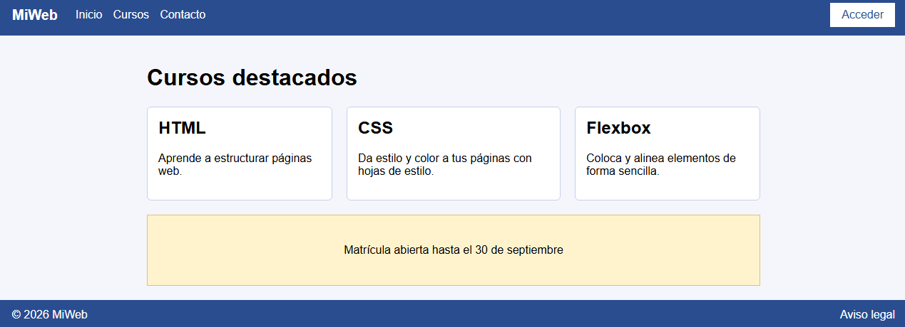

# TAREA 03 (RA2): Menú y tarjetas con Flexbox
Aplicación de CSS para organizar los elementos de una página web mediante Flexbox, trabajando la alineación, distribución del espacio, separación entre elementos y diseño adaptable.

## 🚀 Resultado Visual

## 🛠️ Tecnologías utilizadas
- CSS3
- HTML5
- Visual Studio Code

## 📋 ¿Qué se hizo? (Funcionalidades)
- **Barra de navegación:** Aplicación de `display: flex`, `align-items` y `gap` para colocar el logo, los enlaces y el botón en una misma fila.
- **Enlaces del menú:** Uso de Flexbox para distribuir los enlaces horizontalmente con una separación de 15px.
- **Botón Acceder:** Aplicación de `margin-left: auto` para desplazar el botón hasta el extremo derecho de la barra.
- **Distribución de tarjetas:** Uso de `display: flex`, `flex-wrap: wrap` y `gap` para organizar las tarjetas y permitir que salten de línea cuando no hay espacio suficiente.
- **Reparto del espacio:** Aplicación de `flex: 1 1 220px` para distribuir el ancho disponible entre las tarjetas.
- **Centrado del aviso:** Uso de `justify-content` y `align-items` para centrar el texto horizontal y verticalmente.
- **Pie de página:** Aplicación de `justify-content: space-between` para colocar los textos en extremos opuestos.
- **Comprobación de resultados:** Verificación de la distribución de los elementos en diferentes tamaños de ventana mediante el navegador y las herramientas de desarrollador (F12).

## ⚙️ Cómo ejecutarlo localmente
1. Clona o descarga el proyecto.
2. Abre la carpeta `web-flex` en Visual Studio Code.
3. Abre el archivo `index.html` en un navegador.