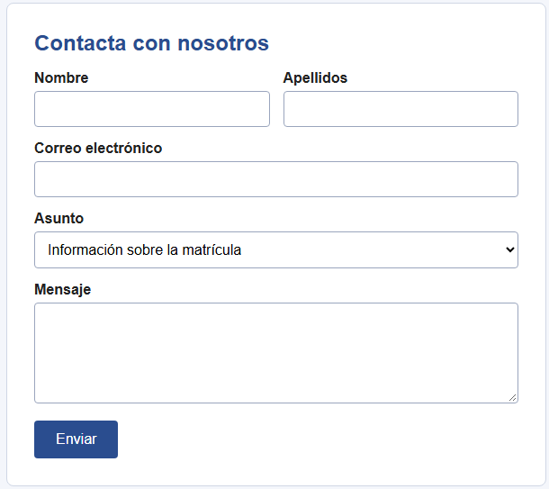

# TAREA 04 (RA2): Formulario de contacto con estilo
Aplicación de CSS para diseñar un formulario de contacto, trabajando el modelo de caja, los selectores, Flexbox y las pseudoclases para mejorar su apariencia e interacción.

## 🚀 Resultado Visual

## 🛠️ Tecnologías utilizadas
- CSS3
- HTML5
- Visual Studio Code

## 📋 ¿Qué se hizo? (Funcionalidades)
- **Modelo de caja:** Aplicación de `box-sizing: border-box` a todos los elementos para evitar desbordamientos.
- **Estilos generales:** Personalización del fondo, la tarjeta principal, el título y los márgenes mediante CSS.
- **Estilos de los campos:** Aplicación de bordes, relleno, esquinas redondeadas y tipografía a los elementos `input`, `select` y `textarea`.
- **Distribución con Flexbox:** Colocación de los campos Nombre y Apellidos en la misma fila, repartiendo el espacio por igual.
- **Diseño del botón:** Personalización del botón Enviar y aplicación del estado `:hover` para cambiar su color al pasar el ratón.
- **Estados de los campos:** Aplicación de `:focus` para destacar el campo seleccionado y `:user-invalid` para señalar un correo electrónico incorrecto.
- **Comprobación de resultados:** Verificación de los estilos y estados del formulario mediante el navegador y las herramientas de desarrollador (F12).

## ⚙️ Cómo ejecutarlo localmente
1. Clona o descarga el proyecto.
2. Abre la carpeta `contacto` en Visual Studio Code.
3. Abre el archivo `index.html` en un navegador.